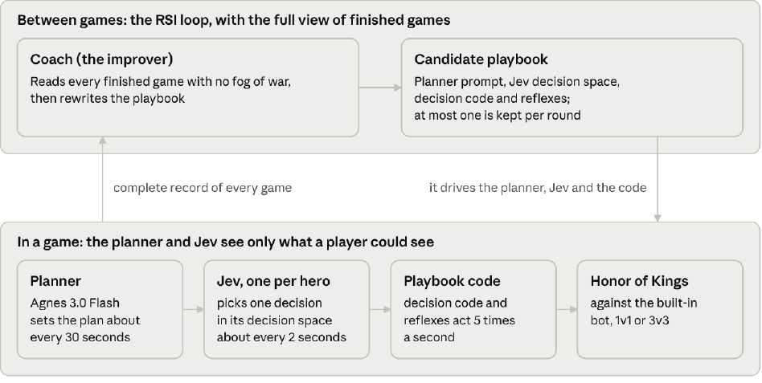
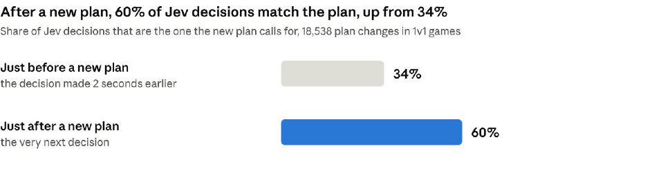
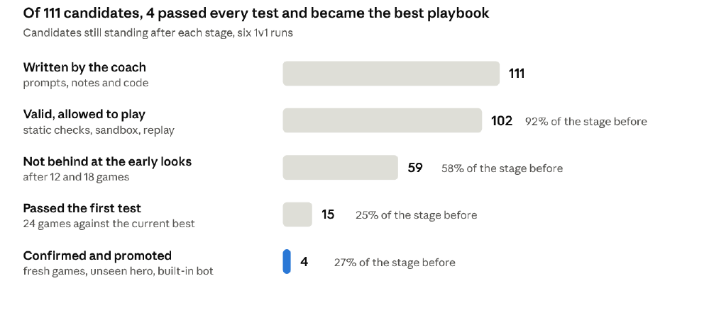
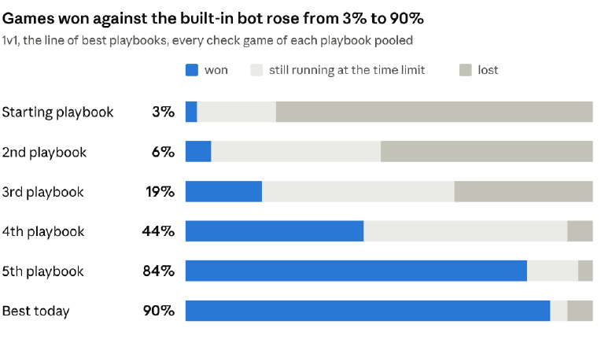
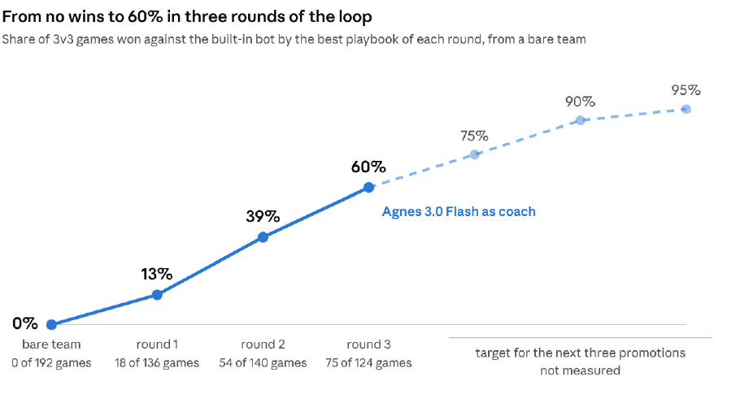
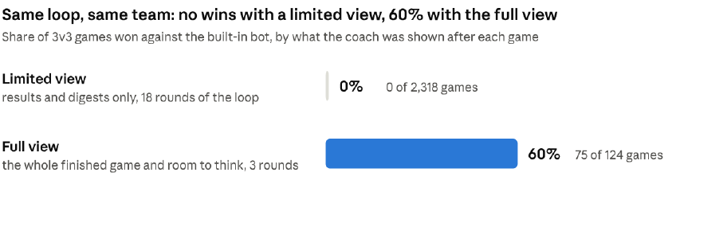

# Agnes RSI Framework: Evidence from Honor of Kings

Oct 12, 2026 · @Aiden

## Summary

This report asks whether a smart large model and a fast decision model, Jev, can work as one, and whether the Agnes RSI Framework can teach them to. We tested it in a new environment, Honor of Kings. A coach model reviews finished games and rewrites the team's playbook, a change is kept only if it passes strict tests, and no model is trained.

- **1v1.** Games won against the built-in bot rose from 3% to 90%.
- **3v3.** A bare team that won no games reached 60% in three rounds of the loop.
- **Fast and smart.** Jev decides in 0.23 seconds, about 7 times faster than the large model's plan, and its next decision follows a new plan 60% of the time, up from 34%.
- **Learnt by itself.** The coach worked out how Jev behaves and rewrote the playbook to fit. The tests are strict: of 111 candidates in 1v1, only 4 were kept.

*Agnes RSI Framework: the loop between games and the parts that play a game.*

## The question: can a smart model and a fast model work as one

This project asks one question: can a smart large language model, combined with a decision model such as Jev, give a system that is both fast and smart? A large model reasons over the whole situation but takes seconds to answer. Jev answers in about a fifth of a second but only chooses within a small decision space. We pair them so that each does the part it is good at.

The combination matters in real life. Robots, cars and other physical devices have to react in real time, and they also need judgement. A system that reasons like a large model and reacts like a small one would serve all of them.

- **The large model reasons.** Agnes 3.0 Flash reads a text report of the situation and sets a plan about every 30 game seconds, that is, seconds of game time.
- **Jev decides.** About every 2 game seconds Jev picks one decision from its decision space, limited to those that fit the moment and the plan.
- **Code acts.** Playbook code carries the chosen decision out five times a second, so a reaction never waits for a model.

The timing leaves room to spare. A decision takes 0.23 seconds and is needed about every 2 seconds of game time; a plan takes 1.7 seconds and is needed about every 30.

The game records show this division of work holding in play. Jev's decision is in control for 76% of the time a hero is alive, and reflexes, the fast rules in the code, send 87% of the spells aimed at the enemy hero.

**The plan reaches Jev.** When the planner sets a new plan, Jev's very next decision moves to the one the plan calls for.

*1v1 run records, October 2026; 18,538 plan changes.*

## What we learnt from our earlier work

Two earlier studies lead to this one. In both, the gain came from the system learning how to use its sub-agents.

**Agnes Harness MAS Mode.** A strong planner offloads work to a cheaper sub-agent, Agnes 2.5 Flash, on terminal tasks. The pair reached the same level of accuracy as the strong model working alone, at about half the cost (48% lower). As the system learnt from task traces, the sub-agent's share of the work, counted in tokens, rose from about one third to 60%. [Read the report](https://github.com/AgnesAI-Labs/Agnes-Harness-MAS-Mode).

**Self-Improving Agent Harnesses.** A harness proposed and tested its own multi-agent pipelines from agent traces, and kept a change only after repeated measurement. Inside this RSI framework the model worked out how to use its sub-agents. Agnes 2.5 Flash went from 24% to 56% of checks passed, and from 4% to 18% of held-out tasks fully solved. [Read the report](https://github.com/AgnesAI-Labs/Self-Improving-Agent-Harnesses).

## Does it generalise: Honor of Kings as a new environment

To see whether the RSI framework generalises, we applied what we learnt from RSI and from multi-agent systems to a game, Honor of Kings. The game is a brand-new environment for both. The planner model sees the game for the first time, and nobody has described Jev, its sub-agent here, to it. Whatever the system comes to know about the game and about Jev has to be found by the coach and written into the playbook. At the start the first 1v1 playbook won 3% of its games, and a bare team of three, heroes with only the simplest playbook, won none of 192.

The RSI framework is the only way the system gets better. Between games a coach model reads what happened, decides which changes should reach the goal, and writes them itself. People set the tests, and the coach cannot move the bar: a change stays only if it passes. No model is trained. What improves is the harness, the prompts, rules and code around the models, which this report calls the playbook. Every step is on record.

## The system: the roles and the playbook

The design borrows from a professional esports team, which gets better between matches, not during them. Such a team has a coach who reviews the finished match with no fog of war, an in-game leader who calls the plan, and players who carry it out.

Our system puts a model in each of these roles. The players and the leader play under the same limits a human team has. The coach studies the finished game with the full view, and its changes are the only way the team improves.

The Agnes RSI Framework gives each role its own model, its own rhythm and its own view of the game. One playbook sets what the playing roles do, and the coach is the only role allowed to change it. The playbook is the only thing that passes from the loop down to a game, and game records are the only thing that passes back up.

| Role | Model | Acts | Is shown | Returns |
| --- | --- | --- | --- | --- |
| Coach | Agnes 3.0 Flash | Between games | The complete record of finished games, including the enemy's true state | Candidate playbooks: prompts, notes, timers, decision and reflex code |
| In-game leader | Agnes 3.0 Flash, the planner | About every 30 game seconds, sooner after a death or when a tower is under attack | A text report of what its own side can see | A short plan: push, farm, trade, defend, retreat or recall, with a focus |
| Player | Jev, a fast decision model | About every 2 game seconds | Its hero's state, the current plan and the decisions open to it right now | One decision, as a probability for each option, in about a fifth of a second |
| Playbook code | None | 5 times a second | The game state | The moves, casts and attacks themselves |

The models read text reports of the game, never pixels. In 3v3 there is one planner for the team and one Jev for each hero.

## How the loop learns: play, review, rewrite, test, promote

No model is trained at any point. What improves is the *playbook*: the planner's prompt and written notes, Jev's decision space, and the code for each decision and reflex. One round of the loop runs five steps.

1. **Play.** The current best playbook plays. Every game is kept as a complete text record, including what each model was shown and what it answered.
2. **Review.** The coach reads its games after they end. It is given the results, digests of the worst games, a table of costly moments (deaths, lost towers), a table of missed chances (a kill window not taken, standing idle while the enemy is dead), and the enemy's true state. It can also query the games with read-only tools.
3. **Rewrite.** The coach writes new versions of the playbook. Each candidate follows one direction of improvement, and the coach decides how many directions to try in a round, from one to six.
4. **Test.** Every candidate goes through the series of tests described below. The coach has no say in how strict they are.
5. **Promote.** At most one candidate a round becomes the new best playbook, and the next round starts from it.

The coach also keeps a memory of every earlier candidate, with its reasoning and its outcome, so a direction that failed is not tried blindly again. When progress stalls, the loop picks its own next goal from measures the game records, such as winning faster.

A candidate replaces the current best playbook only when it wins a fixed series of tests, in order, on games it was never tuned on. In the six 1v1 runs the coach wrote 111 candidates and 4 of them became the best playbook.

*Ledgers of the six 1v1 runs; 111 candidates with a verdict, 5 to 10 October 2026.*

Most candidates change nothing that can be measured. The tests exist to find the rare one that does, and to refuse the ones that only look better by luck.

The tests run in a fixed order: checks that the code is valid and safe, 24 games head to head with the current best playbook, a confirmation on fresh games, games against every earlier best playbook, games on a hero the coach has never seen, and 48 games against the built-in bot. The coach has no say in the number of games or the thresholds, and every decision goes into a ledger.

**How the winner is chosen.** In a round the coach may write several candidates. Each plays the current best playbook in the first test, and one that falls behind is stopped early. The candidate with the best score in that test goes on to the confirmation games, where it must be ahead again by a margin that luck rarely gives, and then to the remaining checks. If it passes them all, it becomes the new best playbook. If nothing passes, the current one stays.

The result is a strict judge. In a simulation built on real game scores, an exact copy of the current best playbook passed the head-to-head tests 1.0% of the time.

## Results: the system learnt the new environment

### 1v1: from 3% of games won to 9 in 10

Against the game's built-in bot in 1v1, the starting playbook won 3% of its games and lost 78%. The best playbook the loop produced wins 90% and loses 6%.

*Run records: 600 games against the built-in bot, six playbooks, 5 to 10 October 2026.*

Each row is one playbook in the line of best playbooks, and every playbook after the first was written by the coach. Four of the five steps were promotions by the run's own tests. The third playbook was a coach-written candidate that beat the best playbook of its time head to head, and we chose it as the next run's starting point.

**The best check: 95.0%, with no loss.** In its 48-game check against the built-in bot the fifth playbook won 42 games, was still playing at the time limit in 6 and lost none. The run scores that check at 95.0%: a win counts 1, a loss 0, and a game at the time limit counts by the share of gold earned and damage done to buildings. Inside that single run, under identical conditions, the score went from 37.6% to 71.2% to 95.0% in two promotions.

**With Agnes 3.0 Flash as planner and coach.** Today's best playbook was promoted with Agnes 3.0 Flash as both planner and coach, and won 43 of its 48 check games. The earlier playbooks in the line were played with an earlier planner and coach model.

**What it cost.** The four runs that carried the system from 3% to the 95.0% check used about 33 US dollars of planner and coach calls at list price, with Jev on our own servers. The simulator waits for the models instead of a clock, so the loop runs as fast as the models answer.

### 3v3: from a bare team to a winning one

A run started from a bare team of three that won none of its 192 games. The bare start was deliberate: nothing learnt in 1v1 was carried in, so every gain comes from the loop. Three rounds of the loop, with Agnes 3.0 Flash as coach, produced a team that wins more games than it loses. Every model in it is our own: Agnes 3.0 Flash plans and coaches, and Jev decides. The dashed part of the line is our **target for the next three promotions, not a measured result**.

*3v3 run records, 12 October 2026; every game of each best playbook against the built-in bot. The dashed part is a target, not a measurement.*

**1v1 lessons carry over.** As a separate check, the playbook the loop evolved in 1v1 was moved by hand to a team of three, with no lesson from a 3v3 game. That team won 33 of its 36 games against the built-in bot, which is why the target on the chart is above 90%: that level is known to be within reach. With the built-in bot on both sides, a team wins about half its games on the same line-ups. The bare-team run found the same rule by itself. In its first round its coach wrote a lane decision that would "hold the wave line, never past the enemy tower's range".

## What the coach is given decides how fast it learns

*3v3 run records, October 2026; 2,318 games with the limited view, 124 games of the full-view best playbook.*

The same loop, the same bare team and the same tests gave opposite results depending on how much of a finished game the coach was shown. With a limited view (results, digests of games and its own earlier candidates), 18 rounds and 56 candidates produced no win. Two things then changed. Given the full post-game view, the way a human coach reviews a match, the coach produced the team's first wins. Given room to think as well, with no cap on its thinking, it built a team that wins 60% of its games in three rounds of the loop.

The full view holds a table of costly moments, a table of missed chances, the enemy's true state, and tools to query any of the current best playbook's games. The planner and Jev get none of it. An automated check rewrites every hidden enemy field in recorded games and requires the text sent to the playing models to stay identical.

## What the coach found: the game, and Jev

The candidates that passed the tests read like a player learning the game. Each change below was written by the coach after reviewing games. Some are about the game, and some are about Jev: what a decision's name makes it do, and when a decision should be offered to it.

In 1v1, the three steps that made a new best playbook:

- It took each hero's real spell reach from the game's own tables.
- It taught the hero to walk with its nearest minions instead of deep past the wave, and to hit an enemy sheltering under its tower from outside the tower's range. This is the step that reached the 95.0% check.
- It stopped treating an enemy it cannot see as gone: a hidden enemy may still be alive, so its absence no longer triggers a deep push.

From the first playbook to today's best 1v1 playbook, it grew from 488 lines to 847, its reflexes from 7 to 12, and its written notes from none to 521 words.

In 3v3, starting from a bare team, in the coach's own words:

- **Round 1:** "79% of alive calls idle at base at 90%+ HP", because "retreat picked 24k of 36k calls". Jev kept choosing retreat, and the heroes camped at their own base. The fix: retreat became a fallback decision that returns to the lane once it is safe.
- **Round 1:** "at 0:24 our level-1 heroes sit at 61-66% with our wave at 39%, inside the enemy outer tower's range". The fix: a lane decision that holds the wave line and never goes past the enemy tower's range.
- **Round 1:** "28 kill windows missed: advance hits the nearest unit, not the kill". The fix: a hunt decision that focuses fire on the enemy that can be killed.
- **Round 2:** "46% of plan words were retreat/heal and under retreat the pickers choose fallback 73%". The pickers are Jev: the coach had found how Jev reads a plan word. The fix: the planner's prompt became an ordered ladder for each hero, "heal" was banned as a plan, and a plan now changes within about 8 seconds of an event.
- **Round 3:** "all 3 enemies dead, both enemy towers gone, crystal 100%", and the "plan word still 'farm'". The fix: with every enemy dead, the heroes clear the wave and push.
- **Round 3:** "6822 push_tower calls come from heroes below 50% hp". The fix: attack a structure only with own minions close by, and step out of range while the tower is shooting the hero.

**The loop also picks its own next goal.** In 1v1, once winning was close to its ceiling, the run recorded that it had stopped improving and the coach chose "win faster" from a table of measures the game records. Later in that run a candidate beat the best playbook in the usual tests.

## The answer so far, and what is open

- **Fast.** Jev decides in 0.23 seconds on average and code acts five times a second, so no reaction waits for the large model.
- **Smart.** The system learnt a game it had never seen: from 3% of games won to 9 in 10 in 1v1, and from no wins to 60% in 3v3 from a bare team.
- **By itself.** Inside a run, every change to the playbook is chosen and written by the coach model, and kept only after passing tests it cannot change.

Still open:

- **A harder opponent.** Every result here is against the game's built-in bot. A much harder opponent, and play between our own teams, come next.
- **Beyond the game.** The same loop should be tried on a second real-time environment, closer to robots and devices.

---

This Markdown edition transcribes the supplied October 12, 2026 PDF for GitHub reading. The six figure images are rendered crops from that PDF; [the original PDF](PAPER.pdf) is the reference edition.
